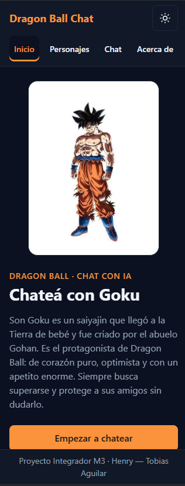
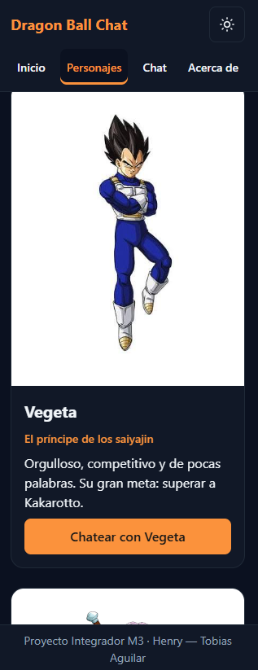
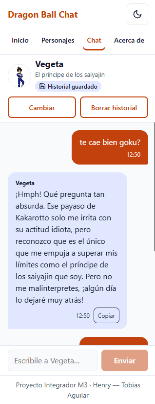
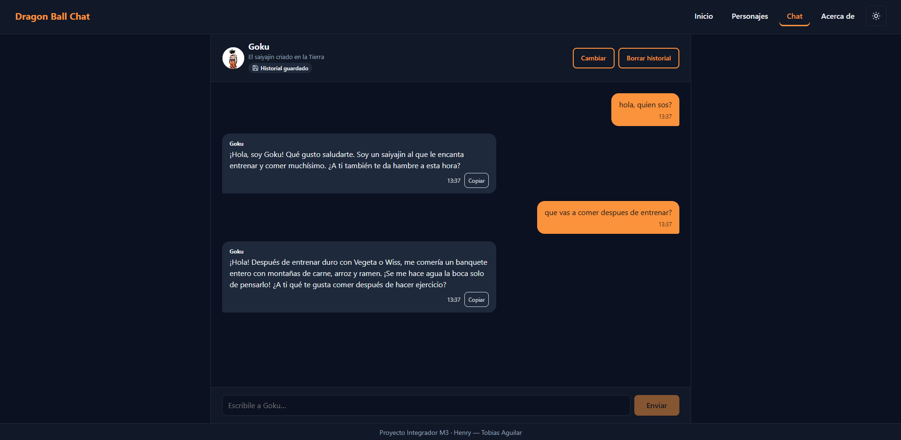

# Dragon Ball Chat — Chatea con tu personaje favorito

Single Page Application responsive para chatear con personajes de **Dragon Ball** usando **Google Gemini**, conectada de forma segura mediante una **Vercel Serverless Function**.

Proyecto Integrador del Módulo 3 — Full Stack, Henry. Autor: **Tobias Aguilar**.

- **App desplegada:** https://chatea-con-tu-personaje.vercel.app
- **Repositorio:** https://github.com/tobiasjesus/ProyectoM3_TobiasAguilar

---

## Personajes

### Goku (personaje principal)
Son Goku es el saiyajin criado en la Tierra y protagonista de Dragon Ball. Es alegre, ingenuo, optimista y tiene un apetito enorme. Vive para entrenar y enfrentar rivales cada vez más fuertes, y protege a sus amigos sin dudarlo. En el chat habla de forma simple y entusiasta, menciona la comida seguido y admite entre risas cuando un tema le resulta complicado.

### Galería (extra)
- **Vegeta:** el orgulloso príncipe de los saiyajin. Seco, arrogante y competitivo; su obsesión es superar a "Kakarotto".
- **Trunks del futuro:** el hijo de Vegeta y Bulma que viajó en el tiempo desde un futuro devastado por los androides. Serio, educado y valiente.

Cada personaje tiene su propio **system prompt**, que define personalidad, forma de hablar, conocimiento, respuestas cortas (1 a 3 oraciones), qué hacer si no sabe algo y qué temas rechaza. Los prompts están en [`lib/characterPrompts.js`](lib/characterPrompts.js).

---

## Funcionalidades

### Alcance obligatorio
- **Vistas con routing SPA (History API):** `/home`, `/chat` y `/about`, sin recargar la página. Back/forward funcionan, la URL refleja la vista y recargar o abrir una URL directa muestra la vista correcta. `/` redirige a `/home` y las rutas inexistentes muestran una página 404.
- **Chat:** mensajes del usuario (derecha, naranja) y del personaje (izquierda) bien diferenciados, input con botón Enviar, indicador "escribiendo…", manejo de errores con botón Reintentar, historial durante la sesión y scroll automático al último mensaje.
- **Integración con Gemini:** system prompt por personaje y **historial completo** (últimos 20 mensajes) en cada request; la respuesta se valida y se muestra como texto.
- **Seguridad:** la API key vive solo en variables de entorno del servidor (`process.env`). El frontend nunca la ve.
- **Responsive mobile-first:** base 320px, breakpoints en **768px** (tablet) y **1024px** (desktop), con Flexbox y Grid.

### Extra credits (los tres implementados)
1. **Persistencia con `localStorage`:** la conversación se guarda por personaje y se recupera al recargar. Hay un botón "Borrar historial" (con confirmación) y un indicador "Historial guardado".
2. **Múltiples personajes:** galería en `/personajes` con tarjetas de Goku, Vegeta y Trunks del futuro, cada uno con su system prompt. El personaje elegido viaja en la URL (`/chat?personaje=vegeta`).
3. **Funcionalidades adicionales:** timestamps en cada mensaje, indicador "escribiendo…" animado, Enter para enviar, botón "Copiar" en las respuestas y modo oscuro/claro con toggle (recuerda la preferencia).

---

## Tecnologías
- HTML, CSS y JavaScript **sin frameworks** (módulos ES, History API, Fetch API, `localStorage`)
- **Vercel Serverless Functions** (Node.js) como proxy hacia Gemini
- **Google Gemini** con el SDK `@google/generative-ai`, modelo `gemini-3.5-flash-lite`
- **Vitest** para tests unitarios

---

## Estructura del proyecto

```
├── api/
│   └── functions.js          # Serverless Function: proxy seguro a Gemini (POST /api/functions)
├── lib/
│   ├── characterPrompts.js   # System prompts de cada personaje (solo servidor)
│   └── chatRequest.js        # Validación del request y conversión al formato de Gemini
├── src/                      # Todo lo que se publica (outputDirectory de Vercel)
│   ├── index.html            # Estructura fija: header, <main id="app">, footer
│   ├── styles.css            # Estilos mobile-first con variables (tema claro/oscuro)
│   ├── app.js                # Punto de entrada: tema, popstate, links y render inicial
│   ├── router.js             # Tabla de rutas, navigateTo, intercepción de links
│   ├── chat.js               # Lógica del chat: historial (memoria + localStorage)
│   ├── api.js                # fetch a /api/functions con manejo de errores
│   ├── utils.js              # Funciones puras de transformación y validación
│   ├── characters.js         # Datos públicos de los personajes
│   ├── theme.js              # Modo claro/oscuro
│   ├── views/                # Una vista por archivo: home, gallery, chat, about, notFound
│   └── img/                  # Imágenes de los personajes
├── tests/                    # Tests con Vitest
├── .env.example              # Variables necesarias (sin valores)
├── vercel.json               # outputDirectory + history fallback de la SPA
└── package.json
```

El flujo de datos separa **fetching** (`api.js`), **transformación** (`utils.js`, `lib/chatRequest.js`) y **render** (`views/`).

---

## Ejecutar en local

### Requisitos
- [Node.js](https://nodejs.org/) 18 o superior (desarrollado con Node 24)
- [Vercel CLI](https://vercel.com/docs/cli): `npm install -g vercel`
- Una API key de Gemini, que se crea gratis en [Google AI Studio](https://aistudio.google.com) → *Get API key*

### Pasos
1. Clonar el repositorio e instalar las dependencias:
   ```bash
   git clone https://github.com/tobiasjesus/ProyectoM3_TobiasAguilar.git
   cd ProyectoM3_TobiasAguilar
   npm install
   ```
2. Crear el archivo `.env` a partir del ejemplo y completar la key:
   ```bash
   cp .env.example .env
   ```
   ```
   GEMINI_API_KEY=tu_api_key
   ```
   El archivo `.env` está en `.gitignore` y **nunca** debe subirse al repositorio.
3. Levantar el proyecto con Vercel CLI, que sirve el frontend y la función serverless juntos:
   ```bash
   vercel login
   vercel dev
   ```
   La primera vez, `vercel dev` pide vincular la carpeta a un proyecto de tu cuenta. Después abrí http://localhost:3000.

---

## Tests

```bash
npm test             # corre todos los tests una vez
npm run test:watch   # modo watch, mientras se desarrolla
```

Hay **32 tests** en 4 archivos, todos pasando:

| Archivo | Qué cubre |
|---|---|
| `tests/utils.test.js` | Transformación del historial para la API (recorte, roles, unión de mensajes), validación de mensajes, formato de hora, lectura segura de `localStorage` y traducción de errores |
| `tests/api.test.js` | `sendChatMessage` con **mock de `fetch`**: respuesta OK, error HTTP (429), error de red y respuesta vacía |
| `tests/app.test.js` | Normalización de rutas del router y datos de personajes |
| `tests/functions.test.js` | Validación del request en el servidor (incluye rechazo de rol `system`), formato `contents` de Gemini y un system prompt por personaje |

---

## Deploy a Vercel

1. Subir el repositorio a GitHub.
2. En [vercel.com](https://vercel.com), crear el proyecto importando el repositorio (o ejecutar `vercel` desde la terminal). No hace falta comando de build: la configuración está en `vercel.json`.
3. En **Settings → Environment Variables**, agregar `GEMINI_API_KEY` como tipo **Secret** para el entorno **Production**.
4. Desplegar con `vercel --prod`. Con el repositorio conectado, cada `git push` a `main` despliega automáticamente.
5. Verificar en producción: abrir la URL en incógnito, chatear, recargar en `/chat` (no debe dar 404) y revisar en DevTools → Network que `POST /api/functions` responda 200.

---

## Decisiones técnicas

- **Modelo `gemini-3.5-flash-lite` en lugar de `gemini-2.5-flash`:** el curso recomendaba `gemini-2.5-flash`, pero al 27/10/2026 ese modelo ya no figuraba en Google AI Studio. Se eligió el modelo Flash económico y rápido vigente, disponible sin plan pago. El nombre del modelo está en una sola constante de `api/functions.js`.
- **System prompts en el servidor:** el navegador solo envía el id del personaje (`goku`, `vegeta`, `trunks`). Así nadie puede modificar la personalidad ni usar la key para otros fines. Además, la función valida el body y rechaza roles distintos de `user`/`model`.
- **Historial recortado:** se envían los últimos 20 mensajes para mantener el contexto sin disparar el consumo de tokens.
- **`vercel.json`:** `outputDirectory: "src"` publica solo la carpeta `src/` (no quedan expuestos `package.json` ni los tests), y el *rewrite* sirve `index.html` en cualquier ruta que no sea `/api/...`, para que recargar `/chat` funcione.
- **Seguridad en el render:** los textos del usuario y de la IA se insertan con `textContent`, nunca con `innerHTML`, para evitar inyección de HTML (XSS).
- **Accesibilidad:** HTML semántico, skip link, foco visible, `aria-current` en la navegación, `role="log"` en el chat, `role="alert"` en los errores, controles de 44px y animación desactivada con `prefers-reduced-motion`.

---

## Capturas de pantalla

| Home en mobile (modo oscuro) | Galería de personajes en mobile (modo oscuro) |
|---|---|
|  |  |

| Chat en mobile (modo claro) | Chat en desktop (modo oscuro) |
|---|---|
|  |  |

---

## Registro del uso de IA

Usé **Claude Code** (asistente de programación de Anthropic) durante todo el proyecto para planificar, explicar conceptos, generar y revisar código y depurar problemas. La configuración de las cuentas y del entorno, la elección de los personajes y del modelo, las pruebas de cada funcionalidad y el control de versiones estuvieron a mi cargo.

### Cómo lo usé
| Etapa | Prompts y uso | Decisiones que tomé |
|---|---|---|
| Material de estudio | Con **Claude (versión web)** armé resúmenes en Markdown del material del módulo (clases, homeworks, consigna y rúbrica) | Usé esos resúmenes como referencia rápida durante el desarrollo, contrastándolos con los PDF oficiales |
| Planificación | Le pedí analizar la consigna, la guía y la rúbrica antes de programar: separar requisitos obligatorios de extras, señalar ambigüedades y armar un plan por etapas con una checklist | Incluir los tres extra credits desde el inicio, respetar la estructura sugerida (`src/`, `api/functions.js`), usar `/home` como ruta principal y guardar los system prompts en el servidor |
| Configuración y deploy | Guía para crear la API key en AI Studio, configurar Vercel CLI y hacer un deploy de prueba temprano | Validar la arquitectura en producción (rutas y función simulada) antes de construir la app, para descartar desde el principio el 404 al recargar `/chat` |
| Interfaz y router | Explicaciones de mobile-first, variables CSS, History API y `popstate`, y revisión del código | Breakpoints en 320, 768 y 1024px, tema claro/oscuro con variables CSS y una vista por archivo |
| Chat, Gemini y tests | Generación y revisión de código para el chat, la función serverless y los tests, a partir de los requisitos de la consigna | Personajes (Goku, Vegeta y Trunks del futuro) y su personalidad, historial por personaje en `localStorage`. Probé cada funcionalidad en el navegador y con Gemini real antes de commitear |

### Dónde la IA se equivocó o hubo que ajustar
- **Modelo inexistente:** siguiendo el curso propuso `gemini-2.5-flash`, pero al buscarlo en AI Studio no estaba disponible. Lo detecté con capturas de la lista de modelos y elegimos `gemini-3.5-flash-lite`.
- **Preguntas de Vercel CLI:** las preguntas de `vercel dev` aparecieron en otro orden y con otros textos que los que había anticipado. Las fui consultando antes de responder.
- **Layout del chat en 320px:** en la primera versión, los botones de la cabecera del chat se apilaban y le quitaban espacio a los mensajes. Se detectó al probar en el navegador a 320px y se corrigió.
- **Deploy automático:** parecía que el push no había desplegado. El diagnóstico mostró que sí: el panel de Vercel todavía no se había actualizado (en GitHub el commit figuraba con estado "Deployment has completed").

### Cómo verifiqué lo que propuso
- Pruebas manuales en el navegador de cada etapa: navegación, back/forward, recarga, 404, Ctrl+click, tamaños 320/768/1024 y modo oscuro.
- `npm test` después de cada cambio.
- Pruebas de la función con Gemini real en local y en producción: personalidad de cada personaje y memoria del historial.
- Revisión de que la API key no aparezca en ningún archivo público y de que `.env` no esté en el repositorio.

---

## Créditos
- Imágenes de los personajes: [dokkaninfo.com](https://dokkaninfo.com/).
- Dragon Ball y sus personajes pertenecen a sus respectivos dueños. Este proyecto es educativo y sin fines comerciales.
